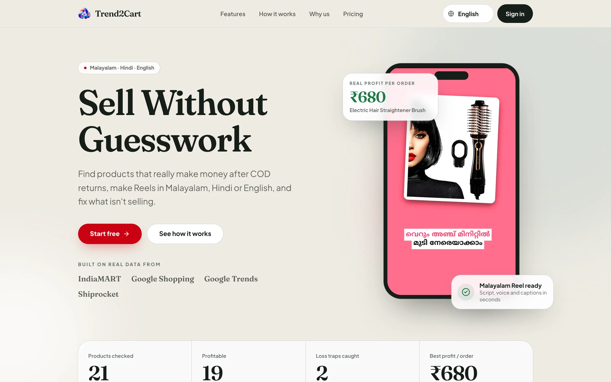
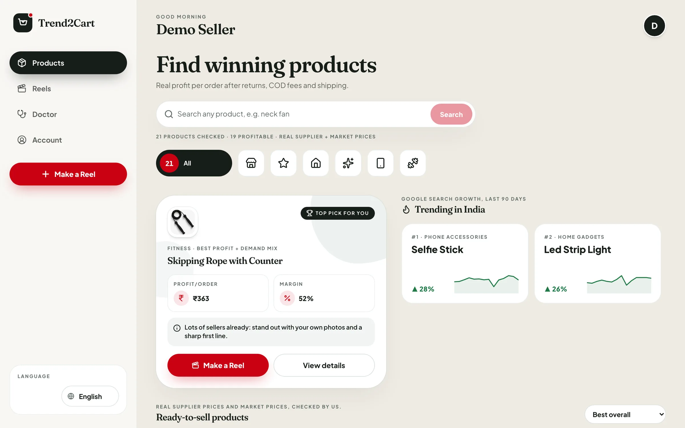
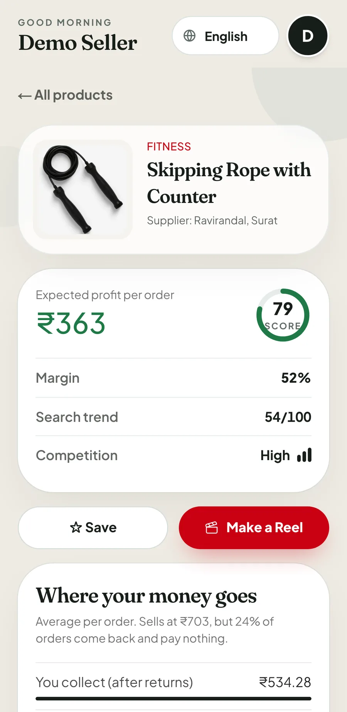
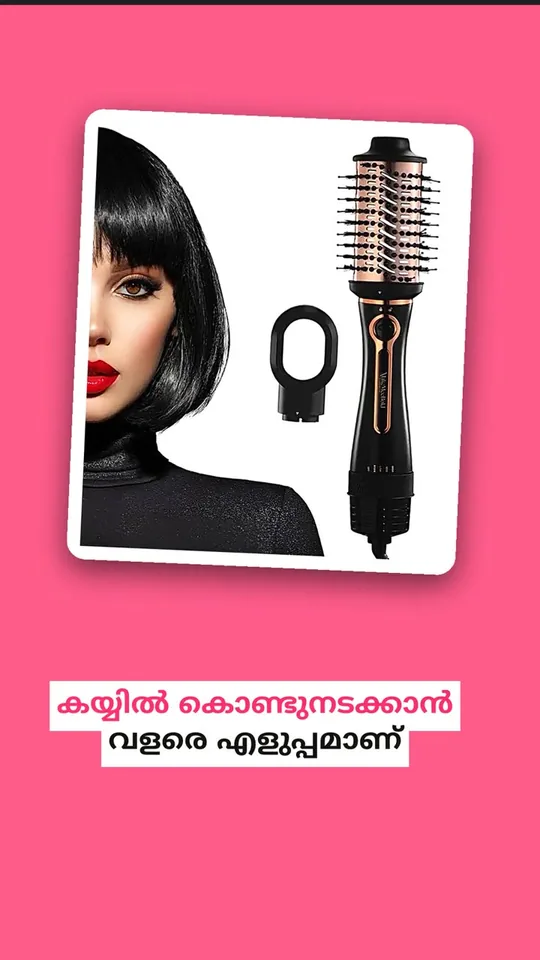
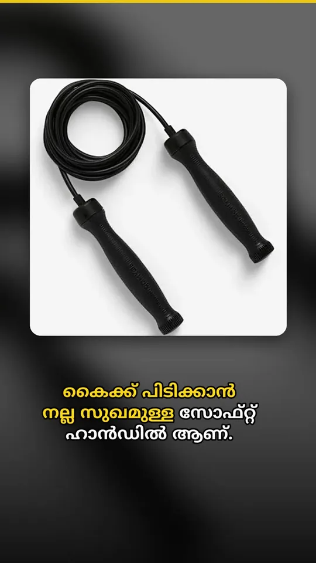
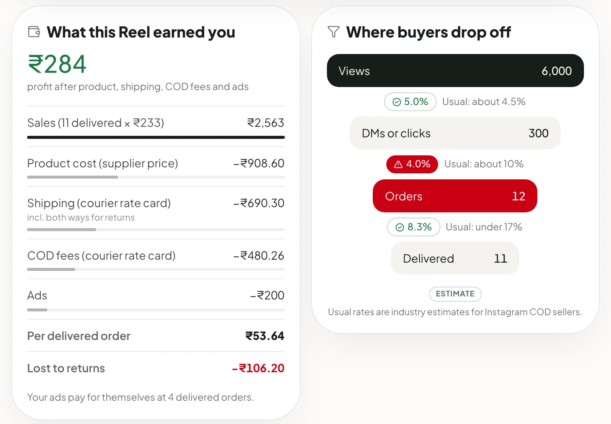
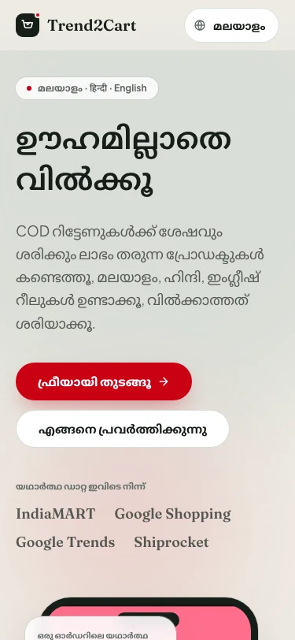

<div align="center">


# Trend2Cart AI

### Sell without guesswork.

Find products that really make money after COD returns, turn them into Reels in Malayalam, Hindi or English,<br/>
and fix what isn't selling, all in one app built for India's social sellers.

<br/>

        

<br/>



<br/>

**[Overview](#overview)** · **[Features](#features)** · **[Real Profit Score](#the-real-profit-score)** · **[Architecture](#architecture)** · **[Tech stack](#tech-stack)** · **[Getting started](#getting-started)**

</div>

<br/>

## Overview

Trend2Cart follows a seller's whole loop in three steps:

<table>
  <tr>
    <td width="33%" valign="top">
      <h3>01 · Find</h3>
      <b>Real Profit Score</b><br/>
      Ranks products by the money left per order after supplier cost, shipping, COD fees, GST, returns and ads.
      Flags loss traps before you buy stock.
    </td>
    <td width="33%" valign="top">
      <h3>02 · Create</h3>
      <b>Vernacular Reels</b><br/>
      A 15–30 second vertical Reel with an AI script, AI voice and word-by-word captions in Malayalam, Hindi or
      English, ready in about a minute.
    </td>
    <td width="33%" valign="top">
      <h3>03 · Grow</h3>
      <b>Conversion Doctor</b><br/>
      Shows what a Reel really earned, where buyers drop off compared with usual rates, and the exact fixes and new
      hooks to try next.
    </td>
  </tr>
</table>

<div align="center">

| **21** | **19** | **2** | **₹680** | **~10 s** |
|:---:|:---:|:---:|:---:|:---:|
| real products scored | profitable after COD | loss traps caught | best profit per order | to render a Reel |

</div>

Every price comes from a real listing. Every assumption is labelled **estimate** and can be edited by the seller.
Anything without real data is hidden rather than guessed.

## Features

### 01 · Find products that actually pay you

<table>
  <tr>
    <td width="77%"></td>
    <td width="23%"></td>
  </tr>
</table>

- **Real profit per order**, with a line-by-line breakdown that always adds up to the rupee.
- **Loss traps** flagged: products that look popular but lose money once COD and returns are counted.
- **What-if simulator:** change the selling price, return rate or ad cost and watch the profit update.
- **Live search and trending:** look up any product, or browse what's trending across India (Google Shopping and
  Google Trends, cached for 7 days).
- **My shop:** add your own product with your own supplier price, and it's scored the same way.

### 02 · Reels in your language, made in a minute

<table>
  <tr>
    <td align="center" width="25%"><br/><sub>Pop Card · Malayalam</sub></td>
    <td align="center" width="25%"><br/><sub>Word-by-word captions</sub></td>
    <td align="center" width="25%"><br/><sub>Bold Night · Malayalam</sub></td>
    <td align="center" width="25%"><br/><sub>Price end card</sub></td>
  </tr>
</table>

- **3-step wizard:** product → audience → language and template. The language follows your region (Kerala →
  Malayalam), and you can change it.
- **Pipeline:** LLM script → Indian-language text-to-speech → karaoke captions → FFmpeg render → 1080×1920 MP4.
- **3 templates** (Bold Night, Pop Card, Fresh Split) with a hook, price badge, progress bar and call-to-action end card.
- **Your own photos** (up to 4), or the product's market photo.
- **Download, copy the caption and hashtags, or share to WhatsApp** in one tap. Full history, and one-tap retry if a
  Reel fails (failed Reels never count against your quota).

### 03 · A doctor for every Reel you post



- Enter views, DMs or clicks, orders and returns.
- See **what the Reel really earned** after returns and ads, and **where buyers drop off** compared with usual rates.
- Get a plain-language diagnosis, **3 fixes**, **3 new hooks** and a **ready-to-send WhatsApp message**, in your language.

### Built for the seller

<table>
  <tr>
    <td width="30%"></td>
    <td valign="top">
      <ul>
        <li><b>Fully multilingual:</b> every screen in Malayalam, Hindi or English. One setting drives both the app and your Reels.</li>
        <li><b>Mobile-first:</b> designed at 375 px, with a full desktop layout.</li>
        <li><b>Simple sign-in:</b> Google or phone OTP, with editable account details.</li>
        <li><b>Plain-language errors</b> that a first-time seller understands.</li>
        <li><b>Plans:</b> Free (3 Reels a month) and a ₹99 founding-member pre-order for unlimited Reels, through Razorpay.</li>
      </ul>
    </td>
  </tr>
</table>

## The Real Profit Score

Expected profit for every order placed. All money is stored as integer paise, never floating point.

```
profit = (1 − r) × (P − C − S − F)  −  r × 2 × S  −  A
```

| | Meaning | Source |
|---|---|---|
| **P** | Selling price | Median of comparable Google Shopping India listings (capped at 8× cost to drop branded outliers) |
| **C** | Supplier cost, incl. GST | IndiaMART supplier quote |
| **S** | One-way shipping, 500 g | Shiprocket rate card + 18% GST = ₹53.10 |
| **F** | COD fee | ₹27 + 1.5% of price, minimum ₹37, + 18% GST |
| **r** | Return-to-origin rate | Category estimate, editable |
| **A** | Ad cost per order | Estimate, editable |

A refused COD parcel earns nothing and costs shipping **twice**, which is the `r × 2 × S` term. The 0–100 score
then weighs:

| Profit margin | Demand | Low competition | Supplier reliability |
|:---:|:---:|:---:|:---:|
| **50%** (30% margin = full marks) | **25%** (Google Trends) | **15%** (sellers on page one) | **10%** (supplier rating) |

Products at ₹0 profit or below are flagged as loss traps. The logic is pure and fully tested in
[`api/core/profit.py`](api/core/profit.py).

## Architecture

```
            ┌─────────────────────────────┐
 Seller ──▶ │  Web · Next.js 16, React 19 │  mobile-first UI · ml / hi / en
            └──────────────┬──────────────┘
                           │ JWT (Supabase Auth)
            ┌──────────────▼──────────────┐       ┌───────────────────────────┐
            │  API · FastAPI              │──────▶│ SerpApi: Google Shopping, │
            │  profit · discover · reels  │       │ Google Trends             │
            │  doctor · preorders         │──────▶│ Gemini (LLM)              │
            └──────┬───────────────▲──────┘       └───────────────────────────┘
                   │ queue job     │ status
            ┌──────▼───────────────┴──────┐       ┌───────────────────────────┐
            │  Supabase                   │◀─────▶│ Reel worker · Docker      │
            │  Postgres + RLS · Auth ·    │       │ script → Sarvam TTS →     │
            │  Storage (Reels, photos)    │       │ captions → FFmpeg render  │
            └─────────────────────────────┘       └───────────────────────────┘
```

- **One shared core:** the API and the worker import the same Python package (`api/core`), so profit maths and the
  Reel pipeline have a single source of truth.
- **Postgres job queue:** the API queues a Reel, the worker picks it up within 2 seconds, renders and uploads the
  MP4, and the app shows friendly progress stages.
- **Private by default:** Row Level Security means each seller can only see their own Reels, check-ups, photos
  and products.
- **Measured costs:** each Reel logs time per stage and AI cost in paise. A typical Reel takes about 10 seconds
  and less than ₹1 of voice.

## Tech stack

| Layer | Technology |
|---|---|
| **Frontend** | Next.js 16 (App Router) · React 19 · TypeScript · Tailwind CSS v4 · lucide-react |
| **Typography** | Fraunces · Plus Jakarta Sans · Noto Sans Malayalam and Devanagari (next/font) |
| **Backend** | Python · FastAPI · Pydantic · httpx · PyJWT · uv |
| **Database, auth, storage** | Supabase: Postgres with Row Level Security, Auth (Google + phone OTP), Storage |
| **AI** | Google Gemini for scripts and diagnoses, through a provider-agnostic OpenAI-compatible client |
| **Voice** | Sarvam AI text-to-speech (`bulbul:v3`), with Google Cloud TTS as a fallback |
| **Video** | FFmpeg + libass (karaoke captions) · Pillow · Docker |
| **Market data** | SerpApi (Google Shopping India, Google Trends) · IndiaMART · Shiprocket rate card |
| **Payments** | Razorpay with server-side signature verification |
| **Quality** | 170 API tests · worker tests · 80-step Playwright end-to-end run on a 375 px phone screen · ESLint |

Runs entirely on free tiers.

## Project structure

```
web/                  Next.js app: landing page, seller app, i18n (ml / hi / en)
api/                  FastAPI: app/ (HTTP routes) + core/ (profit, discover, doctor, reels; shared with worker)
worker/               Reel rendering worker; imports api/core
supabase/migrations/  Postgres schema + Row Level Security
data/products.csv     Sourced product catalog (every row links to its source)
start-local.sh        One-command local run
```

<br/>

# Getting started

## Demo in one command

Needs: [uv](https://docs.astral.sh/uv/), Node 20+, Docker Desktop (running), and filled-in `api/.env` + `web/.env`
(copy the `.env.example` files and add your keys).

```bash
./start-local.sh          # API :8000, web :3000 (production build), Reel maker in Docker
```

Open http://localhost:3000 (Chrome → Cmd+Option+I → phone icon for the mobile view). Ctrl+C stops everything.
Ports are configurable: `WEB_PORT=3100 API_PORT=8100 ./start-local.sh`.
Phone sign-in works with the Supabase **test phone numbers** (section 1); Google sign-in works for anyone.
Reels made while the Reel maker is off wait in the queue and start as soon as it's running.

## 1. Supabase setup (once per project)

1. Create a project at supabase.com.
2. Run **every** file in `supabase/migrations` in filename order (oldest first): paste each into **SQL Editor** and run it
   (or `supabase link` then `supabase db push` with the Supabase CLI).
3. **Authentication → URL Configuration**: Site URL `http://localhost:3000`; add `http://localhost:3000/auth/callback` to Redirect URLs (add the Vercel URL later).
4. **Authentication → Providers → Google**: enable it and paste a Google Cloud OAuth client ID/secret.
   In Google Cloud, set the authorized redirect URI to `https://YOUR-PROJECT.supabase.co/auth/v1/callback`.
5. **Authentication → Providers → Phone**: enable it and choose an SMS provider (Twilio, MessageBird, Vonage or Textlocal).
   Real SMS to Indian numbers needs DLT registration, so for development add **Test phone numbers**
   (e.g. `919999999999=123456`). They sign in with a fixed code and send no SMS.

## 2. Run locally

```bash
# API (http://localhost:8000)
cd api && cp .env.example .env    # fill in values
uv sync && uv run uvicorn app.main:app --reload

# Web (http://localhost:3000)
cd web && cp .env.example .env.local   # fill in values
npm install && npm run dev

# Reel worker (needs FFmpeg with libass, see section 4)
cd worker && cp .env.example .env && uv sync && uv run python main.py
```

Tests: `cd api && uv run pytest` and `cd worker && uv run --with pytest pytest -q test_main.py`

## 3. Product data

- `data/products.csv` is the source of truth. Edit it, then load it: `cd api && uv run python scripts/seed.py`
- Real market data (Google Shopping India price + sellers, Google Trends for Kerala/Tamil Nadu, falling back to
  all of India when local searches are too sparse; set `trend_keyword` to what buyers type) via SerpApi:
  add `SERPAPI_API_KEY` to `api/.env`, then `uv run python scripts/enrich.py` (2 searches per product;
  free plan = 250/month). It updates the CSV and re-seeds. Commit the updated CSV.
- Supplier price (incl. GST), shipping and supplier rating come from real supplier listings, with `source_url`
  and `source_notes` for every row. COD fees are computed from the courier rate card in `api/core/profit.py`.
- Never type guessed prices or scores into the CSV. Products without market data are hidden from sellers.

## 4. Reels (script → voice → captions → render)

- `POST /reels` `{product_id, audience, language: ml|hi|en, template_id: 1|2|3}` checks the plan limit
  (free = 3/month, resets on the 1st, India time), queues a job and returns its id. `GET /reels/{id}` returns
  `queued | processing | done | failed`, plus `video_url`, `caption`, `hashtags` or a plain-language `error`.
- The worker (`worker/main.py`) polls every 2 s, runs `api/core/reels/pipeline.py`, uploads the MP4 to the
  public `reels` Storage bucket and logs seconds per stage and LLM/TTS cost in paise. Failed jobs are refunded.
- Rendering needs FFmpeg **with libass**. Homebrew's ffmpeg doesn't have it, so run the worker in Docker locally:
  ```bash
  docker build -t t2c-api .
  docker run --rm --env-file api/.env t2c-api python /app/worker/main.py
  ```
  (or `brew tap homebrew-ffmpeg/ffmpeg && brew install homebrew-ffmpeg/ffmpeg/ffmpeg`, then `cd worker && uv run python main.py`).
- Photos: sellers can upload up to 4 of their own photos in the New Reel form (private `seller-photos` bucket,
  each seller can only read/write their own folder). Without them, the product's market photo is used.
  Each photo is shown whole on a card over a blurred backdrop, so small store thumbnails don't get stretched.
- Captions highlight word by word as they're spoken (ASS karaoke), with a bigger hook, a bouncing price badge,
  a progress bar and an end-card button. Generative AI video was evaluated and rejected: no free API exists
  (Veo has no free tier; free web tools are watermarked, non-commercial and have no API), and invented product
  footage would mislead COD buyers.
- Try the stages without the database: `worker/experiments/render_sample.py` (usage in its docstring).
- Fonts (OFL, in `worker/assets/fonts`): Noto Sans Malayalam, Mukta (Hindi + Latin), Noto Sans (English, ₹).
  Optional music: see `worker/assets/music/README.md`.
- If uploads from Docker fail locally with `SSL: BAD_RECORD_MAC`, that's Docker Desktop's network on your Mac
  (uploads from the host work). Run the worker on the host instead with a libass FFmpeg (Homebrew tap above).

## 5. Conversion Doctor

`POST /doctor` `{reel_id | product_id, views, clicks, orders, returns}` compares three stages with benchmarks
(views→DMs/clicks ≈4.5%, DMs→orders ≈10%, returns vs the category's RTO estimate; all labeled estimates with
sources in `api/core/doctor.py`), picks the weakest, and the LLM writes an explanation, 3 fixes and 3 new hooks
in the seller's language. `GET /doctor` returns past check-ups.

## 6. ₹99 founding pre-order (Razorpay test mode)

Add `RAZORPAY_KEY_ID` (`rzp_test_…`) and `RAZORPAY_KEY_SECRET` to `api/.env`
(dashboard.razorpay.com → Test Mode → API Keys). `POST /preorders` creates the order; the pricing page opens
Razorpay Checkout; `POST /preorders/verify` checks the HMAC signature server-side and upgrades the plan to
`founding` (unlimited Reels). Without keys the pricing page says payments aren't switched on yet.
Test card: see Razorpay's test-mode docs (e.g. UPI `success@razorpay`).

## 7. Free deployment (optional, later)

| Part | Service (free plan) |
|---|---|
| Web | Vercel Hobby: import repo, **Root Directory = `web`**, add the 3 `NEXT_PUBLIC_*` env vars |
| API + Reel worker | Render free web service from `render.yaml` (Docker; worker runs inside the API container, auto-restarts) |
| DB / Auth / Storage | Supabase Free |
| LLM | Gemini free tier via the OpenAI-compatible wrapper `api/core/llm.py` |
| TTS | Sarvam AI free credits via `api/core/tts.py` (or Google Cloud TTS with `TTS_PROVIDER=google`) |

Render: Dashboard → New → Blueprint → this repo, then fill the secret env vars. After the first deploy,
set `CORS_ORIGINS` to your Vercel URL and set `NEXT_PUBLIC_API_URL` in Vercel to the Render URL.
In Supabase → Authentication → URL Configuration, add the Vercel URL and `<vercel-url>/auth/callback`.

Free-tier gotchas:
- Render sleeps after 15 min idle (~1 min cold start). Open the API URL before a demo.
- Supabase pauses after 7 days without activity; restore it from the dashboard.
- Phone OTP needs a paid SMS provider: use Supabase test phone numbers for demos, Google sign-in for real users.
- Switch LLM provider by changing `LLM_BASE_URL`, `LLM_MODEL`, `LLM_API_KEY` only.
